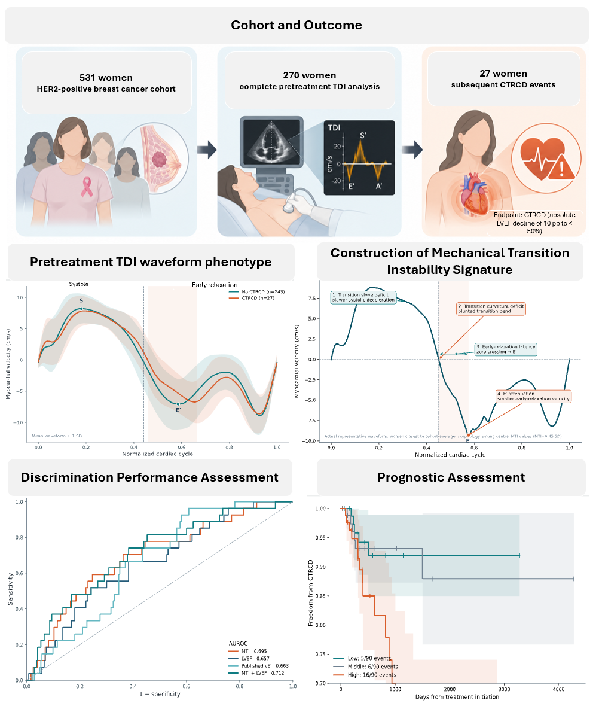

<div align="center">

# Pretreatment Tissue Doppler Mechanical Transition Instability

### Subsequent cancer therapy-related cardiac dysfunction in HER2-positive breast cancer

**BC_cardiotox cohort · interpretable temporal myocardial mechanics · repeated held-out validation**

[**Research website**](https://rdharini2001.github.io/MTI_CardioOncology/) · [**Final manuscript**](manuscript/JCF_MTI_Brief_Report.md) · [**Reproduce the analysis**](#reproduce) · [**Source dataset**](https://doi.org/10.6084/m9.figshare.22650748.v4)

</div>

<p align="center"></p>

## Overview

Cardiovascular surveillance during potentially cardiotoxic cancer therapy remains difficult because early myocardial dysfunction can develop while left ventricular ejection fraction (LVEF) is still preserved. This study asks whether the **shape and timing of pretreatment myocardial motion** contain risk information before conventional systolic function declines.

We developed **Mechanical Transition Instability (MTI)** from a single pretreatment Tissue Doppler Imaging (TDI) cardiac cycle. MTI summarizes four interpretable features of the transition from systolic contraction into early relaxation:

1. **Transition slope deficit** — slower resolution of systolic velocity toward zero.
2. **Transition curvature deficit** — a blunted systolic-to-relaxation bend.
3. **Early-relaxation latency** — later E′ after systolic termination.
4. **E′ attenuation** — smaller early-diastolic velocity.

Higher MTI indicates a more abnormal mechanical transition. The study evaluates association with subsequent cancer therapy-related cardiac dysfunction (CTRCD), discrimination relative to conventional and data-driven comparators, and exploratory incremental value beyond baseline LVEF.

## Study design

| Component | Specification |
|---|---|
| Source cohort | 531 women with HER2-positive breast cancer |
| Study setting | University Hospital of A Coruña, 2007–2021 |
| Pretreatment TDI analysis cohort | 270 women |
| CTRCD events in TDI cohort | 27 (10.0%) |
| Primary outcome | Absolute LVEF decline ≥10 percentage points to <50% |
| Signal representation | One cardiac cycle, 1,001 normalized phases |
| MTI construction | 4 oriented features, training-fold standardization, equal weights |
| Internal validation | 100 repeated stratified 5-fold cross-validation |
| Primary association | Cox regression, HR per 1-SD higher MTI |
| Added-value horizon | Fixed 1 year among women with known 1-year status |

## Main findings

| Analysis | Result |
|---|---:|
| MTI AUROC | **0.695** (95% CI 0.590–0.794) |
| MTI AUPRC | **0.192** |
| MTI Harrell C-index | **0.677** (95% CI 0.570–0.784) |
| Baseline LVEF AUROC | 0.657 |
| Published E′ comparator AUROC | 0.663 |
| MTI + LVEF AUROC | **0.712** (95% CI 0.608–0.807) |
| MTI + LVEF C-index | **0.715** (95% CI 0.611–0.810) |
| MTI HR per 1 SD, adjusted for LVEF | **2.20** (95% CI 1.36–3.55) |
| Preserved baseline LVEF ≥50%, adjusted HR | **2.22** (95% CI 1.41–3.51) |
| Highest vs lower MTI tertiles in preserved-LVEF cohort | **HR 3.38** (95% CI 1.55–7.38) |

The combination of MTI and LVEF had the highest discrimination point estimates, but the paired C-index difference versus LVEF crossed zero. The study therefore supports MTI as a **complementary risk-enrichment signal**, not as a replacement for established cardiac assessment.

## Exploratory 1-year added value

Among 172 women with known 1-year outcome status, including 16 events:

| Model comparison | Result |
|---|---:|
| LVEF AUROC → LVEF + MTI | 0.652 → **0.698** |
| Clinical AUROC → Clinical + MTI | 0.618 → **0.653** |
| Clinical AUPRC → Clinical + MTI | 0.144 → **0.175** |
| Continuous NRI, LVEF → LVEF + MTI | +0.378 (95% CI −0.122 to 0.869) |
| IDI, LVEF → LVEF + MTI | +0.015 (95% CI −0.003 to 0.034) |
| Net benefit at 10% threshold, LVEF → LVEF + MTI | 0.014 → **0.032** |

These analyses are exploratory. Reclassification confidence intervals crossed zero, and no absolute MTI cutoff is proposed.

## Research website

The GitHub Pages site in [`docs/`](docs/) is a dependency-free interactive companion to the manuscript. It includes:

- an animated pretreatment TDI waveform explorer;
- interactive MTI component anatomy;
- model-performance switching across AUROC, AUPRC, and C-index;
- an adjusted hazard-ratio view;
- a surveillance-capacity slider using held-out risk rankings;
- preserved-LVEF risk enrichment;
- exploratory 1-year reclassification and decision-curve summaries;
- a reproducibility map linking every visual to analysis code or stored aggregate output.

The site contains **aggregate data only** and is not a clinical calculator.

## Reproduce

Create an environment and install dependencies:

```bash
python -m venv .venv
source .venv/bin/activate  # Windows: .venv\Scripts\activate
pip install -r requirements.txt
```

Download the original BC_cardiotox file from Figshare and place:

```text
data/BC_cardiotox_clinical_and_functional_variables.csv
```

Then run:

```bash
bash reproduce.sh
```

Equivalent individual commands:

```bash
python src/run_analysis.py
python src/nature_figures_extended.py --bootstrap 5000 --permutations 5000
python src/reclassification_analysis.py
python src/build_site_data.py
```

The primary prediction analysis uses **100 repeated stratified 5-fold cross-validation**. Feature standardization and model fitting occur within training folds only. Held-out predictions are averaged before performance estimation.

## Repository

```text
MTI_CardioOncology/
├── README.md
├── CITATION.cff
├── LICENSE
├── requirements.txt
├── reproduce.sh
├── .github/workflows/
│   ├── pages.yml                  # GitHub Pages deployment
│   └── release-check.yml          # repository consistency checks
├── data/
│   └── README.md                  # source-data instructions; no patient data redistributed
├── docs/                          # interactive GitHub Pages research website
│   ├── index.html
│   ├── styles.css
│   ├── app.js
│   └── assets/
├── manuscript/
│   ├── JCF_MTI_Brief_Report.md    # final manuscript source
│   ├── Table1_Multipanel.md
│   └── Figure_Legends.md
├── notebooks/
│   └── 01_MTI_JCF_analysis.ipynb
├── results/
│   ├── figures/
│   └── tables/
├── src/
│   ├── run_analysis.py
│   ├── nature_figures_extended.py
│   ├── reclassification_analysis.py
│   ├── generate_final_figures_code.py
│   └── build_site_data.py
└── tools/
    └── check_release.py
```

## Data

Patient-level data are **not redistributed** in this repository.

The original dataset is available from the study authors:

- **BC_cardiotox dataset:** https://doi.org/10.6084/m9.figshare.22650748.v4
- **Data descriptor:** Piñeiro-Lamas B, López-Cheda A, Cao R, et al. *Scientific Data*. 2023;10:527. https://doi.org/10.1038/s41597-023-02419-1

The source dataset is distributed under **CC BY 4.0**. Users should cite the original data creators and follow the source license.

## Interpretation guardrails

This is an internally validated study with 27 CTRCD events. The analysis does **not** establish that MTI:

- is superior to LVEF or GLS;
- defines a validated clinical cutoff;
- should replace established cardio-oncology risk assessment; or
- is ready to determine surveillance intensity without external validation.

The supported interpretation is that **pretreatment temporal myocardial mechanics are associated with subsequent CTRCD and may provide complementary baseline risk information**.

## Citation

If you use this repository, please cite the accompanying manuscript and the original BC_cardiotox dataset. Citation metadata are provided in [`CITATION.cff`](CITATION.cff).

## License

Analysis code is released under the MIT License. BC_cardiotox data are not included and remain governed by the original CC BY 4.0 license.
